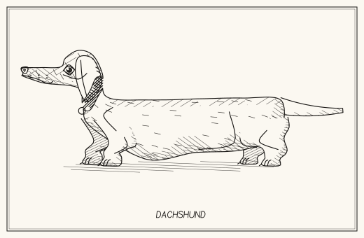

# dogdraw

Procedural SVG dogs with 21 breeds, seeded variations and 10 skeletal animations. No dependencies.



## Try it

Open [`index.html`](index.html) in a browser. Pick a breed, edit its proportions, play a clip or export an SVG.

## Use it

```js
const { writeFileSync } = require('node:fs');
const { draw_dog_svg } = require('./dogdraw');

writeFileSync('dog.svg', draw_dog_svg('dachshund', { seed: 'Milo' }));
```

Animation clips and rig helpers live in [`doganim.js`](doganim.js).

```sh
npm test       # Check rigs, contacts, loops and rendered poses
npm run build # Rebuild index.html and svgs/ (Node.js 20+)
```

## Credits

Inspired by [fishdraw](https://github.com/LingDong-/fishdraw) by Lingdong Huang, with seed, noise and drawing utilities adapted from it.

[MIT license](LICENSE).
